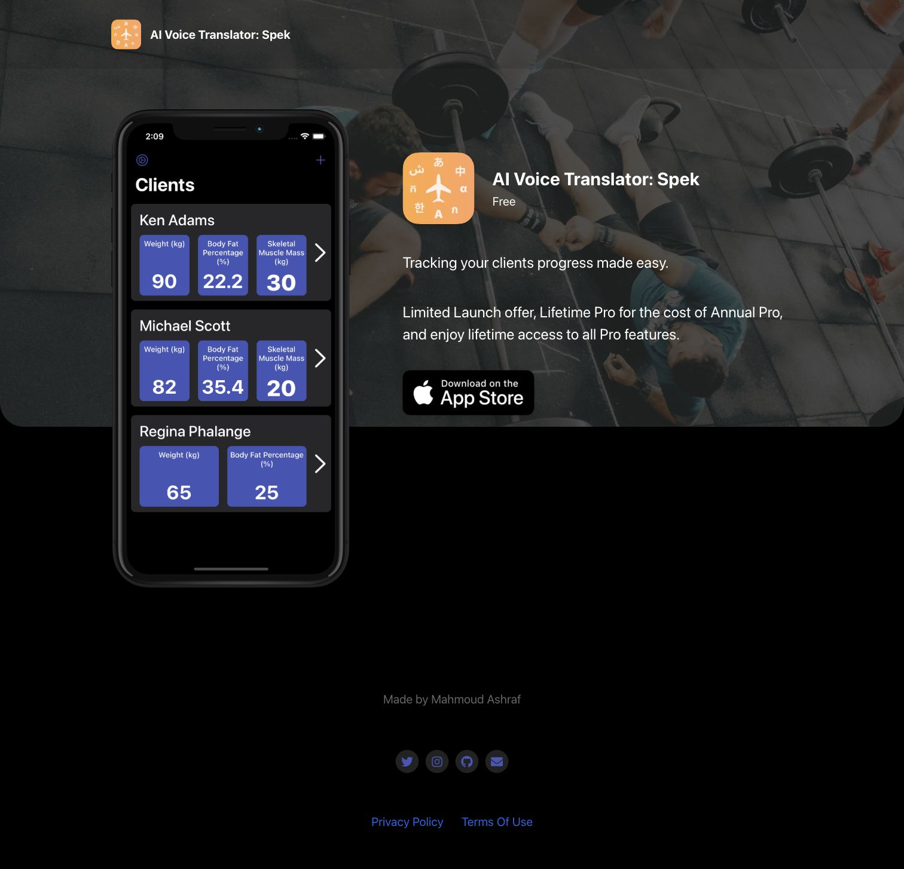
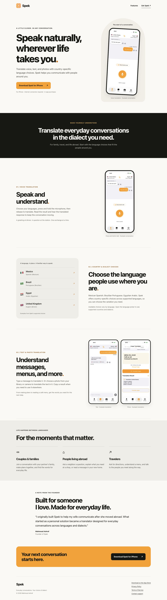
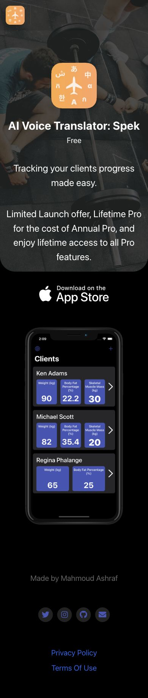
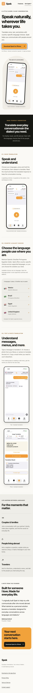

# Landing readiness review

QA inventory: visible global positioning and primary CTA; all three features; supported MX/BR/EG/GB examples; family/abroad/travel use cases; founder attribution; App Store/privacy/terms/support links; SEO/social/canonical metadata; keyboard focus, skip link, phone and desktop layout.

Functional checks: Jekyll build, same-site image/style/link resolution, external CTA URL identity, no external executable scripts, no unrelated product copy, canonical under `/spek-landing/`, real local app icon/screens.

Visual checks: desktop and mobile initial viewport and full page, photo result readability, no horizontal overflow at 320/390/768/1440px, long policy content wrapping, keyboard-only skip/navigation, page without JS.

Verified interactions: open Privacy/Terms under the project subpath and return home; activate the keyboard skip link; confirm every App Store CTA has the same destination. Narrow viewports were checked at 320/390/768/1440 CSS pixels. Browser 200% zoom remains an optional manual check; it is not claimed as executed. No test click purchased anything.

Before screenshots capture the existing production page; after screenshots capture the built local page. The PR does not deploy a preview to a public host or change DNS.

## Desktop

## Mobile

